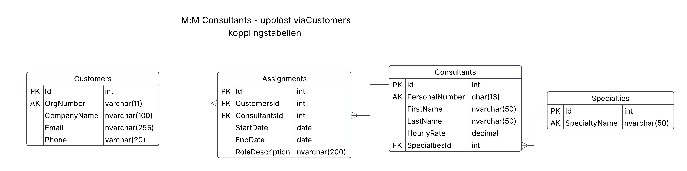

# FailSafe IT – Relationsdatabas

Inlämningsuppgift 1: datamodellering, normalisering och SQL i Microsoft SQL Server.

## Innehåll
- `failsafe_it.sql` – hela skriptet (databas, tabeller, testdata, frågor A–E och verifieringslogg)
- `er-diagram.png` – ER-diagram exporterat från Lucidchart
- Lucidchart-länk: https://lucid.app/lucidchart/8335c078-3ada-4d56-9e1b-d7f489b841fe/edit?view_items=y5~MYU.su__1&page=0_0&invitationId=inv_8b558443-a227-4bf6-bff1-0c7f3184b8f0

## ER-diagram

## Datamodell

Namnstandard: PK heter alltid `Id`. FK heter `<Tabellnamn>Id`.

| Tabell | PK | FK |
|---|---|---|
| Customers | Id | – |
| Specialties | Id | – |
| Consultants | Id | SpecialtiesId → Specialties(Id) |
| Assignments | Id | CustomersId → Customers(Id), ConsultantsId → Consultants(Id) |

**Relationer**
- Customers 1:M Assignments
- Consultants 1:M Assignments
- Specialties 1:M Consultants
- Customers M:M Consultants – upplöst via kopplingstabellen **Assignments**

Assignments har en egen `Id` istället för en sammansatt PK (CustomersId, ConsultantsId), eftersom samma kund kan hyra samma konsult för flera olika uppdrag med egna datum och rollbeskrivningar.

## Normalisering

**1NF:** Alla kolumner innehåller atomära värden (ett telefonnummer, ett datum, ett förnamn och ett efternamn i separata fält) och det finns inga upprepade kolumngrupper eller kommaseparerade listor. Varje tabell har en primärnyckel som unikt identifierar varje rad.

**2NF:** Samtliga tabeller har en primärnyckel bestående av en enda kolumn (`Id`), så partiella beroenden kan inte uppstå. Alla icke-nyckelattribut beror på hela nyckeln – t.ex. beror StartDate och RoleDescription på uppdragets Id och inte bara på kunden eller konsulten.

**3NF:** Det finns inga transitiva beroenden. Kundens företagsnamn och konsultens namn lagras bara i sina egna tabeller; Assignments refererar till dem via främmande nycklar istället för att kopiera uppgifterna. Specialitet har brutits ut till en egen tabell (Specialties) så att samma specialitet inte skrivs om, och riskerar felstavas, på varje konsult. Organisationsnummer och personnummer har UNIQUE-villkor men används inte som primärnycklar, så att känsliga uppgifter inte sprids som FK i andra tabeller.

## DevSecOps-reflektion

**Sec – SQL Injection:** Applikationen bygger aldrig SQL genom strängkonkatenering utan använder parametriserade frågor (`cmd.Parameters.Add("@OrgNumber", SqlDbType.VarChar, 11)`) eller Stored Procedures, så att indata alltid behandlas som data och aldrig som kod. Dessutom körs appen med en egen databasanvändare enligt Least Privilege: `DENY` på direkt tabellåtkomst och `GRANT EXECUTE` endast på de procedurer den behöver, så att den aldrig kan köra t.ex. `DROP TABLE`.

**Ops – Prestanda vid stora datamängder:** Jag lägger ett NONCLUSTERED INDEX på kolumnen OrgNumber (i skriptet via `CONSTRAINT UQ_Customers_OrgNumber UNIQUE NONCLUSTERED`), så att SQL Server kan göra en Index Seek istället för en Table Scan över miljontals rader. Motsvarande index finns på FK-kolumnerna i Assignments för snabbare JOINs och FK-validering.
